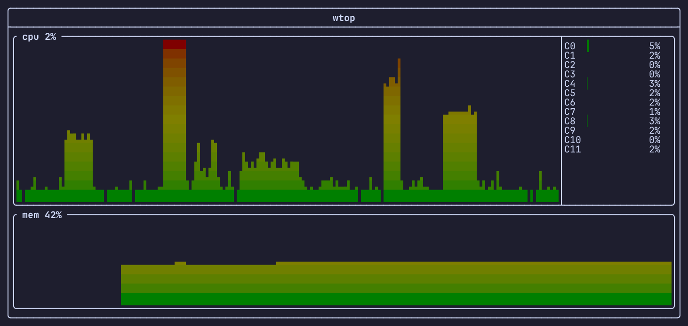

# wtop

[](https://github.com/TWinston-66/wtop/actions/workflows/ci.yml)

Minimal TUI Linux resource monitor in C++.



## Requirements

- CMake 3.25 or newer
- C++26 (tested with GCC 14 and newer)

## Install

Download a prebuilt static binary for x86_64 or aarch64 from the
[releases page](https://github.com/TWinston-66/wtop/releases):

```sh
tar -xzf wtop-<version>-linux-<arch>.tar.gz
./wtop-<version>-linux-<arch>/wtop
```

## Build

```sh
cmake -S . -B build
cmake --build build
```

## Usage

```sh
./build/wtop
```

## Roadmap

1. Process list + control
2. Network stats

## License

See [LICENSE](LICENSE).
